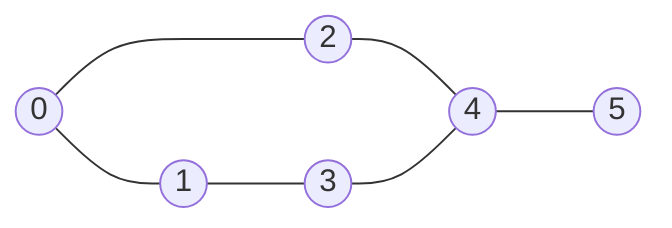
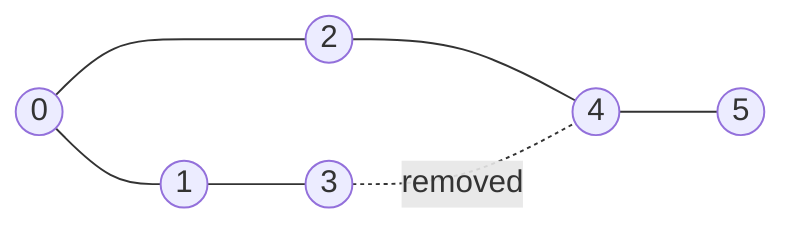

# 1. What is a graph?

A graph is a collection of **objects** and the **relationships** between them.

In symbols, **G = (V, E)**: V is the set of vertices (nodes, the objects), E is the set of edges (the connections).

Picture the nodes as cities and the edges as roads.

<small>The Lesson 1 graph: 6 vertices, 6 edges. The original diagram wasn't in the transcript; this edge set is reconstructed from the checkpoint grading (deg(4) = 3, a cycle exists, everything is reachable from 0, and 3 reaches 4 via 3 → 1 → 0 → 2 → 4). It is the only 6-edge graph consistent with all four facts.</small>

## Core terminology

| Term | Meaning |
|---|---|
| Vertex / node | An individual object |
| Edge | A connection between two nodes |
| Undirected graph | Connections work both ways: A ↔ B |
| Directed graph | Connections have a direction: A → B |
| Weighted graph | Every edge has a cost, distance or weight |
| Degree | Number of edges incident to a node (undirected) |
| Path | A sequence of nodes where each consecutive pair is connected |
| Cycle | A path that returns to its start without repeating other nodes |
| Connected component | A **maximal** group of mutually reachable nodes |
| Bridge | An edge whose removal disconnects a connected graph |

### Two distinctions that pick the algorithm later

- **Directed vs undirected** decides whether you add an edge once or twice when building the graph.
- **Weighted vs unweighted**: in an unweighted graph every edge is one step. With weights, edges cost different amounts. This is exactly the line between **BFS** (unweighted shortest path) and **Dijkstra** (weighted).

## The complexity habit

For graphs we name two sizes: **V** = number of vertices, **E** = number of edges.

If an algorithm visits each vertex once and examines each edge a constant number of times, it costs **O(V + E)**.

::: tip Why plus and not times?
The work is "process every vertex" **plus** "process every connection". Those are two separate piles of work, not one nested inside the other. The proper derivation is in [BFS → complexity](./03-bfs#complexity-derivation).
:::

## Checkpoint 1 3 / 4 {#checkpoint-1}

| Question | My answer | Result |
|---|---|---|
| Degree of node 4? | 3 | ✅ |
| Does the graph contain a cycle? | Yes | ✅ (0-1-3-4-2-0) |
| Can node 0 reach every other node? | Yes | ✅ |
| If edge 3–4 is removed, does the graph stay connected? | No | ❌ Correct: **Yes** |

::: info My answer, verbatim
"Graph Lesson 1 checkpoint answers: 1. Degree of node 4: 3; 2. Cycle present: Yes; 3. All nodes reachable from node 0: Yes; 4. Graph after removing edge 3–4: No."
:::

### What went wrong in Q4

Node 3 can still reach node 4: **3 → 1 → 0 → 2 → 4**. So the graph stays connected, and 3–4 is **not a bridge**. Any edge that lies on a cycle can never be a bridge, because the rest of the cycle is a detour around it.

::: warning Pattern: concluding before tracing
I answered without looking for an alternate path. The same habit caused the Lesson 3 skip and the Round 2.1 mistake. Before saying "disconnected", try to walk around the removed edge. See the [mistake log](/learning/mistake-log).
:::
