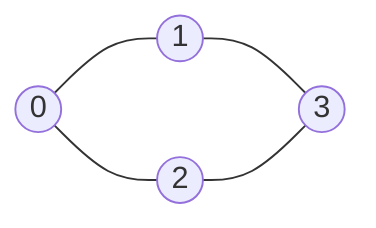

# 2. Graph representations

A graph is just nodes and connections, but the computer needs a data structure. There are three fundamental ones. We use this graph throughout:



## A. Edge list

Store each connection as a pair.

```python
n = 4
edges = [(0, 1), (0, 2), (1, 3), (2, 3)]
```

Simple, but ask "who are the neighbours of node 1?" and you must scan every pair:

```python
for u, v in edges:
    if u == 1:
        print(v)
    elif v == 1:
        print(u)
# 0, 3
```

- Storage: **O(E)** (O(V + E) if you also store per-node data)
- Neighbours of a node: **O(E)**
- Add an edge: amortized **O(1)**
- Natural fit: algorithms that process edges in some order, like **Kruskal's MST** (sort the edge list).

## B. Adjacency matrix

A V × V grid; `matrix[u][v] = 1` means u–v is an edge.

|   | 0 | 1 | 2 | 3 |
|---|---|---|---|---|
| **0** | 0 | 1 | 1 | 0 |
| **1** | 1 | 0 | 0 | 1 |
| **2** | 1 | 0 | 0 | 1 |
| **3** | 0 | 1 | 1 | 0 |

For an undirected graph, set **both** `matrix[u][v]` and `matrix[v][u]`, so the matrix is symmetric.

- Storage: **O(V²)**, even when there are almost no edges. This is the big cost.
- Is u–v an edge? **O(1)**
- Neighbours of u: **O(V)** (scan the whole row)
- Build: **O(V² + E)**

## C. Adjacency list

For each node, a list of its neighbours. This is the default for BFS, DFS and most CP problems.

```python
graph = [
    [1, 2],  # neighbours of 0
    [0, 3],  # neighbours of 1
    [0, 3],  # neighbours of 2
    [1, 2],  # neighbours of 3
]
```

### Building it from input, dry run

Input `4 4 / 0 1 / 0 2 / 1 3 / 2 3`:

| Read | graph |
|---|---|
| start | `[[], [], [], []]` |
| (0, 1) | `[[1], [0], [], []]` |
| (0, 2) | `[[1, 2], [0], [0], []]` |
| (1, 3) | `[[1, 2], [0, 3], [0], [1]]` |
| (2, 3) | `[[1, 2], [0, 3], [0, 3], [1, 2]]` |

- Storage: **O(V + E)**. Why: V lists, and each undirected edge is stored twice, so 2E entries. O(V + 2E) = O(V + E).
- Neighbours of u: **O(deg(u))**
- Is u–v an edge? **O(deg(u))** with a plain list (use a set per node if you need O(1))
- Add an edge: amortized **O(1)**

## Code

::: code-group
<<< @/../code/graphs/python/representations.py#solution [Python]
<<< @/../code/graphs/java/Representations.java#solution [Java]
:::

## Comparison

| Operation | Edge list | Matrix | Adjacency list |
|---|---|---|---|
| Space | O(E) | O(V²) | O(V + E) |
| Check edge u–v | O(E) | O(1) | O(deg(u)) |
| Iterate neighbours of u | O(E) | O(V) | O(deg(u)) |
| Typical use | Edge processing (Kruskal) | Dense graphs, Floyd-Warshall | BFS / DFS |

::: tip CP heuristic
Start with an adjacency list unless the problem gives you a reason not to (an adjacency matrix as input, V ≤ ~1000 with dense edges, or O(1) edge lookups).
:::

::: warning Directed edges
Input `2 4` meaning 2 → 4 is **only** `graph[2].append(4)`. Adding both directions silently turns a directed problem into an undirected one.
:::

## Checkpoint 2 <span class="verdict ok">5 / 5</span> {#checkpoint-2}

::: info My answers, verbatim
"Graph representations checkpoint answers: Q1 8; Q2 O(N²); Q3 Only graph[2].append(4); Q4 O(7), generally O(degree); Q5 Adjacency list."
:::

| Question | My answer | Result |
|---|---|---|
| Undirected graph, 5 vertices, 4 edges: total adjacency-list entries? | 8 | ✅ (2E) |
| Space of an adjacency matrix with N vertices? | O(N²) | ✅ |
| Directed edge `2 4`? | Only `graph[2].append(4)` | ✅ |
| Iterating a node with 7 neighbours? | O(7), generally O(deg(u)) | ✅ |
| 100,000 vertices, 50,000 edges: which is more memory-efficient? | Adjacency list | ✅ (10¹⁰ matrix cells vs ~2×10⁵ list entries) |

::: details Subtle point from Q4
Exactly seven neighbours is seven operations, a constant. In general analysis the number of neighbours varies with the input, so we write O(deg(u)).
:::
