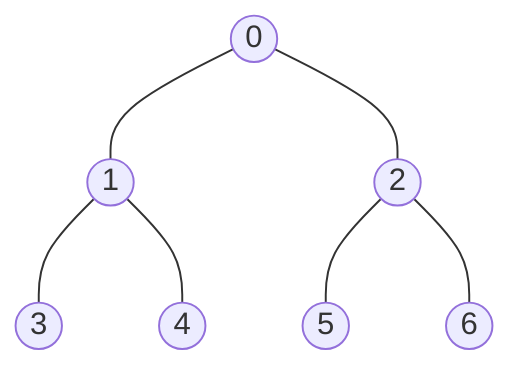

# 3. BFS (Breadth-First Search)

## Intuition

You're in a city and want to visit every building reachable from where you stand. BFS visits **nearby buildings first**, expanding outward ring by ring: everything 1 road away, then everything 2 roads away, and so on.

That "ring by ring" order is the whole point. It's why BFS finds **shortest paths in unweighted graphs**.

## The lesson graph



```python
graph = [
    [1, 2],     # 0
    [0, 3, 4],  # 1
    [0, 5, 6],  # 2
    [1],        # 3
    [1],        # 4
    [2],        # 5
    [2],        # 6
]
```

The order inside each list matters when tracing.

## The data structure: a queue (FIFO)

First in, first out, like a ticket counter. In Python use `collections.deque`: `append` adds at the back, `popleft` removes from the front, both O(1). (`list.pop(0)` is O(n) because every element shifts.) In Java use `ArrayDeque` with `offer` / `poll`.

## Algorithm

1. Mark the start visited and put it in the queue.
2. While the queue isn't empty: pop the front node, process it, and for each neighbour **not yet visited**, mark it visited **and then** enqueue it.

::: danger The detail interviewers test: mark on ENQUEUE
Mark a node visited **when you add it to the queue**, not when you remove it. If two nodes both discover the same neighbour, marking immediately stops it from being queued twice. Marking on dequeue is the bug explored in [Interview Rounds 2 to 2.2](./interview/visited-timing), and one version of it is **exponential**.
:::

## Code

::: code-group
<<< @/../code/graphs/python/bfs.py#solution [Python]
<<< @/../code/graphs/java/Bfs.java#solution [Java]
:::

`shortest_distances` uses `dist[v] == -1` as "undiscovered", so no separate visited array is needed.

## Dry run from node 0

| Step | Pop | Newly discovered | Queue after (front → back) | Order so far |
|---|---|---|---|---|
| 0 | — | 0 (start) | `[0]` | — |
| 1 | 0 | 1, 2 | `[1, 2]` | 0 |
| 2 | 1 | 3, 4 (0 already visited) | `[2, 3, 4]` | 0 1 |
| 3 | 2 | 5, 6 | `[3, 4, 5, 6]` | 0 1 2 |
| 4 | 3 | — | `[4, 5, 6]` | 0 1 2 3 |
| 5 | 4 | — | `[5, 6]` | 0 1 2 3 4 |
| 6 | 5 | — | `[6]` | 0 1 2 3 4 5 |
| 7 | 6 | — | `[]` | 0 1 2 3 4 5 6 |

Distances from 0:

```
Node:      0  1  2  3  4  5  6
Distance:  0  1  1  2  2  2  2
```

## Complexity derivation

The trap: there's a loop inside a loop, so it *looks* like O(V²).

```python
while queue:                       # how many times?
    node = queue.popleft()
    for neighbor in graph[node]:   # how many times in TOTAL?
        ...
```

Count the operations instead of multiplying loop headers:

1. **Outer loop**: a vertex is enqueued only when it flips from unvisited to visited, which happens at most once. So at most **V** pops.
2. **Inner loop, summed over the whole run**: each vertex's list is scanned once (when it's popped). The lists hold **2E** entries in total for an undirected graph (E for directed).
3. Total: O(V) + O(2E) = **O(V + E)**.

Space:

| Item | Space |
|---|---|
| `visited` / `dist` | O(V) |
| Queue | up to O(V) (each vertex at most once) |
| **Auxiliary total** | **O(V)** |
| Including the adjacency list | O(V + E) |

::: warning With an adjacency matrix it really is O(V²)
Finding u's neighbours means scanning a whole row of V cells, for every one of V vertices.
:::

## Why BFS gives shortest paths (unweighted)

The queue always holds nodes at distance d followed by nodes at distance d + 1, never anything else. So nodes are popped in non-decreasing distance order, and the first time a node is discovered is via a shortest path. Formal proof and "what breaks with weights" are scheduled for Interview Round 3.

## Lesson 3 checkpoint <span class="verdict pending">Skipped</span> {#lesson-3-checkpoint}

I skipped this checkpoint in the session. That skip is logged as an instance of *concluding before tracing*. Attempt it on paper before looking at the tables above:

1. Full BFS order from node 0.
2. Full recursive DFS first-visit order from node 0 (see [DFS](./04-dfs)).
3. What remains in the BFS queue after processing nodes 0 and 1?
4. Minimum number of edges from node 0 to node 6?
5. In your own words, why is BFS with an adjacency list O(V + E) rather than O(V²)?
