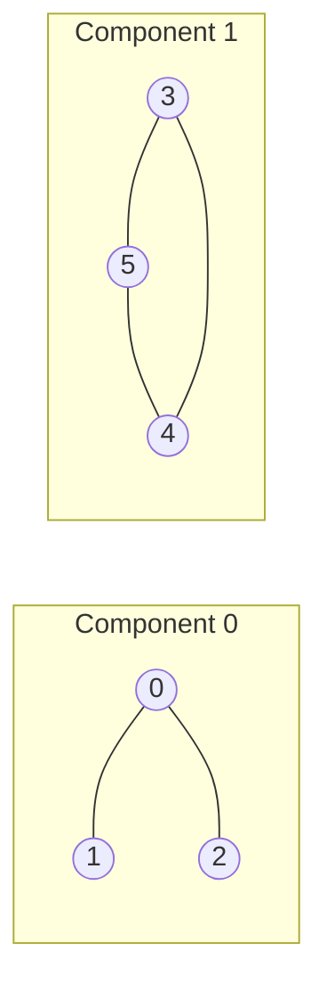

# 5. Connected components

A **connected component** is a maximal group of nodes that can all reach each other. "Maximal" means you can't add another node and keep the property.

<small>The LC 1971 example graph: 0 and 5 are in different components, so no path exists.</small>

## Why components matter

Once every node has a **component id**, "can u reach v?" becomes `comp[u] == comp[v]`: **O(1) per query** after one O(V + E) labelling pass. That's the jump from LC 1971 (one query) to problems with 10⁵ queries.

## Special case: points on a line ([Frog Messages](./problems/frog-messages))

When "edge" means "distance ≤ K" on a number line, you don't need to build edges at all. Sort the positions; two neighbours in sorted order are in the same component iff their gap ≤ K, and a gap > K splits everything left of it from everything right of it. O(N log N), no graph built.

## The general algorithm

Pending This section gets written after I attempt [LC 547 Number of Provinces](./problems/lc-547) on my own. The guiding question:

> If you run DFS from every node, how do you avoid counting the same component multiple times?

## Practice

| Problem | Status |
|---|---|
| [LC 547 Number of Provinces](./problems/lc-547) | ⬜ assigned, not attempted |
| LC 323 Number of Connected Components | ⬜ |
| LC 1319 Number of Operations to Make Network Connected | ⬜ |
