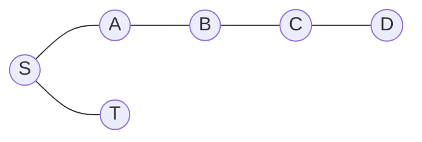

# Interview: BFS vs DFS

Interviewer format: one question at a time, I reason first, then a verdict, a counterexample and a harder follow-up. Complexity has to be derived, not recited.

## Round 1 · Which would you choose? <span class="verdict partial">Partially correct</span> {#round-1-which-would-you-choose}

### Question

> You've implemented LC 1971 with both BFS and DFS. An undirected, unweighted graph has **V = 100,000** and **E = 200,000**, a source S and destination T. You only need to know whether a path exists. BFS or DFS?
>
> Don't just say "both are O(V + E)". Compare: time and space including the data structures; worst case on a **long chain** vs a **very wide graph**; **Python-specific** risks; whether either can **terminate early**. Then give a final choice.

### My first answer, verbatim

::: info In my own words
"I will BFS because it moves in increasing order of distance parralelly in all directions so possibility for finding destination is earlier than dfs which traverses a route particularly for worst case dfs will travers last for destination will bfs will find it earlier , for long chain dfs is better for a wide chain bfs is better, bfs will terminate early instead of checking to full depths"
:::

### What held up

- BFS explores in increasing order of distance from the source.
- BFS can find a destination quickly when it's close to the source.
- DFS goes deep along one branch before backtracking.
- BFS can stop early when it finds the destination.

### The challenges

**1. "BFS finds the destination earlier" is not a guarantee.**



With S's list as `[A, T]`, BFS sees T while processing S, but recursive DFS goes S → A → B → C → D, backtracks, and only then finds T. Flip the list to `[T, A]` and DFS finds T just as fast. **BFS guarantees shortest-path distance, not fewer operations.**

**2. "DFS is better for a long chain" needs qualifying.** On a 100,000-node chain both are O(V + E). But in Python, BFS's queue stays tiny and safe, while **recursive DFS hits `RecursionError`**. Iterative DFS avoids that. So DFS isn't automatically better on chains; recursive DFS is actually the risky one.

**3. Both can terminate early.** Either stops the moment it discovers T. Actual speed depends on graph shape and neighbour order.

### Model answer

| Property | BFS | DFS |
|---|---|---|
| Worst-case time | O(V + E) | O(V + E) |
| Auxiliary space | O(V) | O(V) |
| Structure | Queue | Stack / recursion |
| Long chain | Queue holds ~1 node | Stack is V deep (Python recursion fails) |
| Wide graph (star) | Queue can hold ~V nodes | Active stack often small |
| Shortest unweighted path | Guaranteed | Not guaranteed |
| Early termination | Yes | Yes |

**Final choice for reachability only:** either **BFS or iterative DFS**, with that justification. In Python I'd avoid recursive DFS at V = 10⁵.

## Round 1.1 · Challenge your own reasoning <span class="verdict ok">Correct</span> {#round-1-1}

### Question

```
S ── A ── B ── C ── D ── E ── T
│
├── X1
├── X2
│   ...
└── X10000
```

All X nodes are dead ends. S's neighbours are stored as `[A, X1, X2, ..., X10000]`. Both algorithms follow list order, DFS is recursive, both stop on discovering T.

> Which finds T after examining fewer nodes? Give the exact exploration order. Does "BFS finds it earlier" still hold?

### My answer, verbatim

::: info In my own words
"in the discovering order given the dfs will work best because it will start from a and go in depth and reach t while bfs will check all a and x nodes first, so no bfs is not always better it depends highly on graph structure and order of edges"
:::

### Model answer

- **DFS:** S → A → B → C → D → E → T. It follows the first branch and never touches the 10,000 dead ends.
- **BFS:** processing S enqueues A, X1, …, X10000. Everything at distance 1 is processed before anything at distance 2, so it pops all 10,000 dead ends before it even reaches B, and then continues level by level to T.
- Both are still O(V + E) worst case. On **this input** DFS does far less work.
- The advantage depends on neighbour order: if S's list were `[X1, …, X10000, A]`, DFS would visit every dead end first.

::: tip Key insight
An algorithm's **guarantee** (BFS: minimum number of edges) is not the same as its **performance on a particular input** (how many nodes it touches before stopping).
:::

## Follow-ups to practise

- On a star graph with V = 10⁵, what's the peak queue size in BFS? The peak stack size in iterative DFS (marking on push)?
- You now need the *shortest* path from S to T. Does your answer change? (Round 3 territory.)
