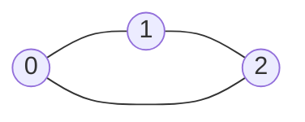
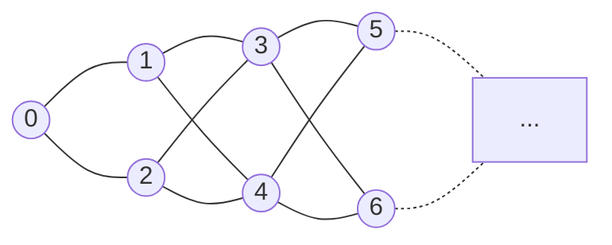

# Interview: visited timing (mark on enqueue vs dequeue)

The BFS template marks a node visited **when it's enqueued**. These rounds change that one detail and ask what breaks. The theme: **"in the queue" and "visited" are different states when you mark on dequeue.**

## Round 2 · Complexity trap <span class="verdict partial">Partially correct</span> {#round-2-complexity-trap}

### Question

```python
from collections import deque

def bfs(graph, start):
    visited = set()
    queue = deque([start])

    while queue:
        node = queue.popleft()

        if node in visited:
            continue

        visited.add(node)

        for neighbor in graph[node]:
            queue.append(neighbor)
```

> Undirected graph, adjacency list. Visited is marked only on removal.
> 1. **Correctness:** does it still visit every reachable vertex? Can a vertex enter the queue more than once?
> 2. **Complexity:** still O(V + E), or O(V²) or worse? Derive it by counting insertions and edge examinations.
> 3. **Counterexample:** a small graph where a vertex is inserted twice before its first removal.

### My first answer, verbatim

::: info In my own words
"ye all nodes are still reachable but the issue is bcz we are not checking already visited nodes before appending so already visited nodes are again entering the queue makeing it longer and probably more than v2 also in time complexity, , the example from the question we did in leetcode has a example where 2 enters queue again even before when it was reached first"
:::

| Part | Verdict |
|---|---|
| Correctness (all reachable nodes visited) | ✅ |
| Duplicates can enter the queue | ✅ |
| Complexity "probably more than V²" | ❌ It's O(V + E) |
| Counterexample | Right idea, needed an explicit graph |

### Counterexample: a triangle



Neighbours in ascending order:

| Step | Removed | Queue after |
|---|---|---|
| start | — | `[0]` |
| 1 | 0 | `[1, 2]` |
| 2 | 1 | `[2, 0, 2]` ← 2 is already waiting and gets inserted again |
| 3 | 2 | `[0, 2, 0, 1]` |
| 4 to 7 | 0, 2, 0, 1 | all already visited → `continue` |

### Model answer: count the operations

- A vertex's adjacency list is scanned only on its **first** removal. Every later removal hits `continue` in O(1).
- So the lists are scanned once in total: **2E** scans, and each scan makes **one** insertion → at most 2E + 1 insertions and removals.
- Time: **O(V + E)**. Same class as the template.
- Space is what got worse: the queue can hold **O(E)** entries instead of O(V).

Verified by simulation: on the triangle, 7 removals and 6 scans (= 2E).

::: tip Key insight
More operations doesn't mean a worse Big-O class. Count what each operation costs and how many times it can happen.
:::

## Round 2.1 · Remove the `continue` <span class="verdict wrong">Incorrect</span> {#round-2-1-remove-the-continue}

### Question

```python
def bfs(graph, start):
    visited = set()
    queue = deque([start])

    while queue:
        node = queue.popleft()
        visited.add(node)

        for neighbor in graph[node]:
            if neighbor not in visited:
                queue.append(neighbor)
```

Marks on dequeue, checks `visited` before appending, but no longer skips nodes that are popped again.

> Is it still O(V + E)? Can the same node's list be processed more than once? Can the queue grow well beyond E?

### My answer, verbatim

::: info In my own words
"queue does not take xtra space in this , complexity is still v+e , no the same node will not enter queue again"
:::

| My claim | Verdict |
|---|---|
| Queue doesn't take extra space | ❌ |
| Time is still O(V + E) | ❌ |
| The same node won't enter again | ❌ |

### Where the reasoning broke

I assumed "already in the queue" implies "already visited". With marking on dequeue that's false: a node sitting in the queue is **not yet visited**, so every neighbour that pops before it can append it again. And since there's no `continue`, **each copy rescans the whole adjacency list**.

Triangle trace:

| Step | Dequeued | Visited | Queue after |
|---|---|---|---|
| start | — | {} | `[0]` |
| 1 | 0 | {0} | `[1, 2]` |
| 2 | 1 | {0, 1} | `[2, 2]` |
| 3 | 2 | {0, 1, 2} | `[2]` |
| 4 | 2 again | {0, 1, 2} | `[]` ← list of 2 scanned a second time |

### Corrected complexity: exponential, not O(V·E) {#correction}

::: danger Correction to the answer given in the session
The session's answer said the worst case is **O(V·E)** (O(V³) for dense graphs), reasoning that one node can be processed up to O(V) times. **That's too optimistic.** Duplicates **cascade**: each duplicate pop of a node re-enqueues all of its still-unvisited neighbours, so copies multiply level by level. The worst case is **exponential** in V. The other parts of the session's answer (queue grows beyond O(V), the fix is to mark on enqueue) stand.
:::

**Counterexample: a 2-wide ladder.** Node 0, then k levels of 2 nodes each; every node connects to both nodes of the next level. V = 2k + 1, E = 4k − 2.



FIFO order means every copy of a level-L node is popped before any level-(L+1) node, so level-(L+1) nodes are still unvisited when **each** of those copies is popped. Each copy enqueues both next-level nodes:

| Level | Queue entries for that level |
|---|---|
| 0 | 1 |
| 1 | 2 |
| 2 | 4 |
| L | 2ᴸ |

Total pops = 1 + 2 + 4 + … + 2ᵏ = **2ᵏ⁺¹ − 1 = 2^((V+1)/2) − 1**.

Simulated with the exact Round 2.1 code (see the simulation below; it runs on every `npm run verify`):

| k | V | E | V·E | Round 2 pops | **Round 2.1 pops** | Round 2.1 scans |
|---|---|---|---|---|---|---|
| 5 | 11 | 18 | 198 | 37 | 63 | 184 |
| 8 | 17 | 30 | 510 | 61 | 511 | 1,528 |
| 11 | 23 | 42 | 966 | 85 | **4,095** | 12,280 |

At V = 23, Round 2.1 already does 4,095 pops, more than 4× the O(V·E) "bound" of 966. Round 2 (with `continue`) stays at exactly 2E + 1.

:::: details The simulation code
::: code-group
<<< @/../code/graphs/python/visited_timing.py#solution [Python]
<<< @/../code/graphs/java/VisitedTiming.java#solution [Java]
:::
::::

Space: the queue holds 2ᵏ entries at once at the last level, so memory is exponential too.

::: tip Lesson
When counting operations, also count **how many times each node can be popped**. That count can itself blow up.
:::

## Round 2.2 · Fix the bug <span class="verdict pending">Pending</span> {#round-2-2}

> Change the **minimum number of lines** in the Round 2.1 code so that:
> - every vertex is enqueued at most once,
> - time is O(V + E),
> - queue + visited memory is O(V),
> - every reachable vertex is still visited.
>
> Send the corrected function in Python and Java, and explain why each change restores those guarantees. Trace one small graph first.

The fix is deliberately not written here until I've answered it.

## Up next

Round 3: why BFS finds shortest paths and ordinary DFS doesn't, and what breaks when edges have weights.
