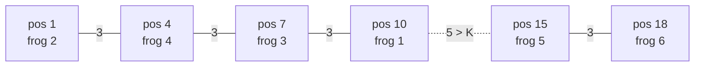

# CodeChef · Frog Messages

<span class="verdict partial">Solved after seeing the solution</span> · Connected components · Sorting

## Problem

N frogs sit on a number line; frog i is at position Aᵢ (several can share a position). Two frogs communicate **directly** if their distance is ≤ K, and messages can be **relayed** through other frogs. Answer P queries: can frog u send a message to frog v?

**Constraints:** 1 ≤ N, P ≤ 10⁵ · 0 ≤ Aᵢ, K ≤ 10⁹ · time limit 1 s

```
Input            Output
6 3 4
10 1 7 4 15 18
2 1              Yes   (2→4→3→1 at positions 1→4→7→10, each step 3)
3 4              Yes   (7 and 4, distance 3)
1 5              No    (10 and 15, gap 5 > K, nobody in between)
5 6              Yes   (15 and 18)
```

Second sample, `K = 0`, `A = [5, 9, 5, 12]`: (1,3) Yes (same position), (1,2) No, (4,4) Yes (a frog can talk to itself).

My first message about it, verbatim: *"i think this is also graph question Frog Messages"*. Right instinct; the modelling step is where I needed help.

## Modelling: nodes, edges, query

- **Nodes:** frogs
- **Edges:** |Aᵢ − Aⱼ| ≤ K
- **Query:** are u and v in the same [connected component](../05-connected-components)?

Building the edges explicitly is too expensive: in the worst case (all frogs close together) there are N(N−1)/2 ≈ 5 × 10⁹ pairs.

## Key insight: sort, then only adjacent gaps matter



After sorting, any relay from a left frog to a right frog has to cross **every gap** between them. So if one adjacent gap is > K, nothing on its left can reach anything on its right; if all gaps along the way are ≤ K, the adjacent frogs form a relay chain. Start a new component id at each gap > K.

| Frog | Position | Component |
|---|---|---|
| 1 | 10 | 0 |
| 2 | 1 | 0 |
| 3 | 7 | 0 |
| 4 | 4 | 0 |
| 5 | 15 | 1 |
| 6 | 18 | 1 |

## Code

::: code-group
<<< @/../code/graphs/python/frog_messages.py#solution [Python]
<<< @/../code/graphs/java/FrogMessages.java#solution [Java]
:::

The solution shown in the session read each query with `input()`. With P = 10⁵ that's usually fine but slow in Python; reading all input at once (`sys.stdin.read().split()`) and printing once is the safer CP habit, so the notebook version does that. Java uses one `StringBuilder` for output.

## Complexity

| Step | Time |
|---|---|
| Sort (position, index) pairs | O(N log N) |
| One pass over adjacent gaps | O(N) |
| P queries, O(1) each | O(P) |
| **Total** | **O(N log N + P)** time, O(N) extra space |

## Edge cases

- Duplicate positions: gap 0 ≤ K, always same component (works even with K = 0).
- u = v: always Yes.
- K = 0: only frogs at identical positions connect.
- Values up to 10⁹: gaps fit in a 32-bit int, but the Java version uses `long` anyway.
- Frog numbers are input order, so keep the original index through the sort.

## Open follow-up <span class="verdict pending">Unanswered</span> {#open-follow-up}

> K = 4, A = [2, 6, 10, 14]. Frog 1 is at 2 and frog 4 is at 14, a direct distance of 12 > K. Can frog 1 still reach frog 4? Why?

## Try it

Answer the follow-up above first, then check your reasoning here. The input is pre-filled with the first sample. Edit it into the second sample and your own edge cases (all frogs at one position, K = 0, u = v). See [Playground](/playground) for how it works.

<Playground id="frog-messages" stdin="6 3 4\n10 1 7 4 15 18\n2 1\n3 4\n1 5\n5 6\n" />
