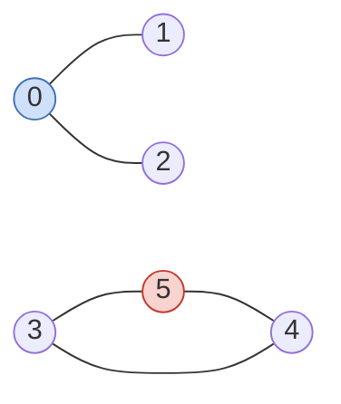

# LC 1971 · Find if Path Exists in Graph

<span class="verdict ok">Solved (BFS and DFS)</span> · Easy · Reachability · [LeetCode](https://leetcode.com/problems/find-if-path-exists-in-graph/) · Complexity review **4 / 5**

## Problem

n nodes labelled 0 to n−1, a list of undirected edges, a `source` and a `destination`. Return `True` if a path exists between them.

```
n = 6, edges = [[0,1],[0,2],[3,5],[5,4],[4,3]], source = 0, destination = 5
Output: False   (0 and 5 are in different components)
```



Constraints: up to 2 × 10⁵ nodes and edges, so a chain can be 2 × 10⁵ deep. That matters for recursion.

## My submission (DFS), verbatim

I solved it with both BFS and DFS and sent the DFS version with my own complexity comments:

<<< @/../code/graphs/python/lc1971_kavya_dfs.py{python}

## Review

### What was right

- The logic is correct, including `source == destination`.
- **Return propagation**: `if dfs(neigh): return True`. This fixed the mistake from my earlier DFS attempt. Without it, a deeper call can find the destination and the outer calls still finish with `False`:

```
dfs(0)
  └── dfs(1)
        └── dfs(2)
              └── found 5 → True
        ← True
  ← True
← True
```

### The one correction <span class="verdict partial">4 / 5</span> {#the-one-correction}

```python
visited = [False]*n
#O(1) creation      ← wrong
```

Python has to initialise n slots: **O(n) time and O(n) space**. Only `[]` (an empty list) or `visited[source] = True` (one assignment) is O(1).

| Line | Time | Extra space |
|---|---|---|
| `adj = [[] for i in range(n)]` | O(V) | O(V) |
| `if source == destination` | O(1) | O(1) |
| `for u, v in edges` | O(E) | O(E) neighbour entries |
| `visited = [False] * n` | **O(V)** | **O(V)** |
| `visited[source] = True` | O(1) | O(1) |
| `dfs(source)` | O(V + E) | O(V) recursion stack |

T = O(V) + O(E) + O(V) + O(V + E) + O(1) = **O(V + E)**. Space S = **O(V + E)** total, or O(V) auxiliary if you exclude the graph.

### Two improvements

1. **Check the destination at the top of `dfs`** so `dfs(node)` simply means "is destination reachable from node?". Cleaner than comparing every neighbour.
2. **Recursion depth.** A 2 × 10⁵ chain overflows Python's ~1000-frame default (and Java's default stack too, tested at 5 × 10⁴). Iterative DFS or BFS is the robust choice.

## Reference solutions

::: code-group
<<< @/../code/graphs/python/lc1971.py#solution [Python]
<<< @/../code/graphs/java/Lc1971.java#solution [Java]
:::

Both O(V + E) time, O(V + E) space including the adjacency list.

## Edge cases to say out loud in an interview

- source == destination (including n = 1, no edges) → True
- No edges, n ≥ 2, source ≠ destination → False
- Disconnected graph (the example)
- Deep chain → recursion limit
